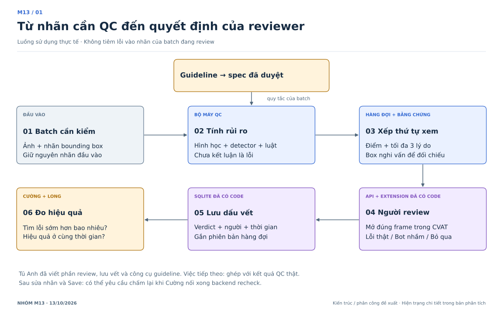
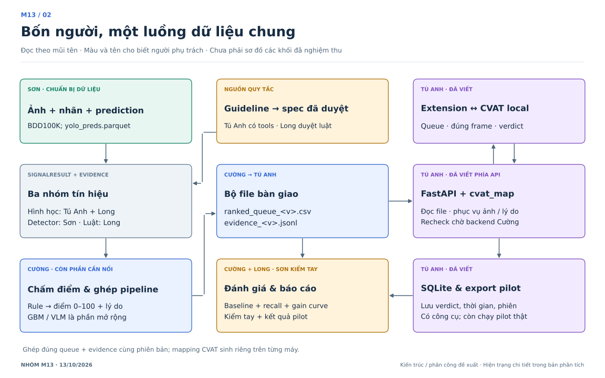
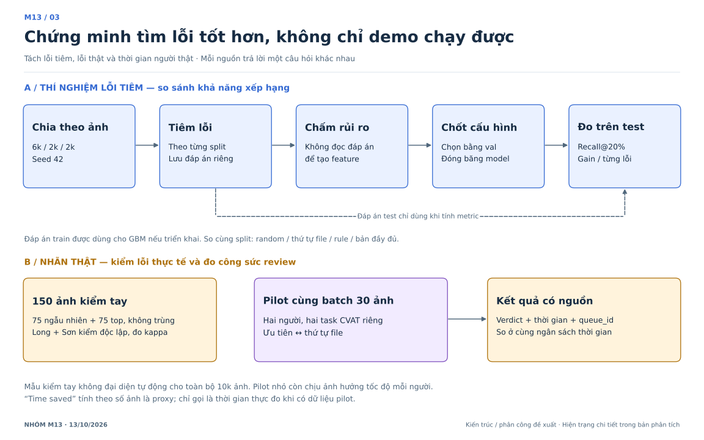
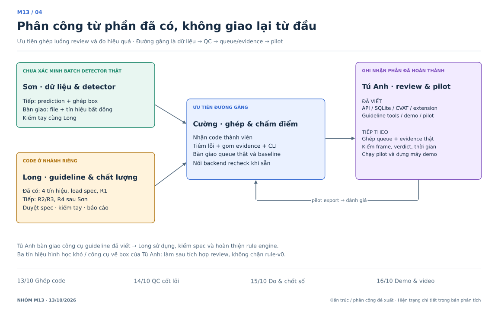

# M13 — Phân tích lại đề tài và phân công ngày 13/10/2026

**Bản dành cho người không chuyên:** [10 việc cần làm, hướng dẫn từng bước và điều kiện hoàn thành](huong-dan-cong-viec-de-hieu.md).

**Nên xem trước:** [Ví dụ xuyên suốt bằng hình: ảnh + guideline → LLM trích luật → kiểm nhãn → điểm và review](vi-du-xuyen-suot.md). Hai hình bổ sung chỉ rõ đầu vào, đầu ra từng bước và các box A–D cụ thể.

**Kết luận:** nhóm đã có một phần đáng kể của hệ thống review do **Tú Anh viết**. Việc cần ưu tiên là ghép phần đó với bộ phát hiện rủi ro, tạo hàng đợi có bằng chứng và đo hiệu quả trên nhãn thật. Không giao lại API, extension hay LLM đọc guideline như những việc chưa bắt đầu.

Bản này cập nhật hiện trạng sau `git fetch origin` ngày 13/10 và đề xuất phân công tiếp theo. Lịch 13–16/10 lấy từ bản điều phối ngày 12/10 trong `CONTRIBUTING.md`. Những điều chỉnh dưới đây là đề xuất tổ chức công việc, chưa phải xác nhận cả nhóm đã nhận việc.

## 1. Đề tài thực sự giải quyết việc gì?

**Câu hỏi nghiên cứu:** với cùng ngân sách review, thứ tự ưu tiên dựa trên tín hiệu hình học, detector và guideline có giúp tìm được nhiều lỗi nhãn detection 2D hơn thứ tự ngẫu nhiên hoặc thứ tự file không?

- **Đầu vào:** ảnh, nhãn bounding box hiện tại và guideline áp dụng cho batch.
- **Đầu ra:** danh sách ảnh cần xem trước, điểm rủi ro 0–100, tối đa 3 lý do tiếng Việt và vị trí box nghi vấn.
- **Người quyết định:** reviewer kiểm ảnh và ghi `error`, `false_alarm` hoặc `skip`. Điểm cao là nghi ngờ, không phải xác nhận nhãn sai; điểm 80 không mặc nhiên là xác suất sai 80%.
- **Giá trị cần chứng minh:** tìm lỗi sớm hơn và hiệu quả review tốt hơn, không chỉ có giao diện chạy được.
- **Phạm vi bản nộp:** detection 2D trên BDD100K; review qua CVAT + extension đã có. Chuyển sang giao diện khác lúc này sẽ phát sinh công việc tích hợp.

**Hai luồng phải tách rõ:** vận hành dùng nhãn đang cần QC; thí nghiệm mới tiêm lỗi để tạo đáp án. Không tiêm lỗi vào nhãn thật của người dùng trước khi review.

### Hình 1 — Người dùng đi qua hệ thống thế nào?

[Bản vector để đưa vào slide](diagrams/01-luong-qc.svg). Hình mô tả luồng mục tiêu; không có nghĩa mọi khối đã được tích hợp.

## 2. Đã có gì? Phải xem đúng nhánh

Nhánh đang mở `chore/cuong-lich-3-ngay` và `develop` tại thời điểm kiểm tra cùng ở `a508ecc`. Nhiều module trên nhánh này còn stub, nhưng code của thành viên đã nằm trên nhánh riêng. **“Đã có code trên nhánh” khác với “đã merge và nghiệm thu toàn hệ thống”.** Chưa thấy dữ liệu pilot thật hoặc kết quả chạy đủ 10k ảnh trong phần đã kiểm tra.

| Phần | Bằng chứng trong repo | Kết luận và việc tiếp theo |
|---|---|---|
| API review, SQLite, queue theo phiên bản, verdict và thống kê | Tú Anh: `origin/feat/tuanh-review-flow`, `36829fc`; `src/api/main.py`, `service.py`, `store.py` | Đã viết; ghép với queue/evidence thật và kiểm thử xuyên suốt |
| Extension side panel, mở frame CVAT, đo thời gian | Cùng nhánh; `extension/` và test trình duyệt | Đã viết; xác minh trên máy demo và dữ liệu thật |
| Cài/import/sync CVAT, dựng demo | `cvat_install.py`, `cvat_import.py`, `cvat_sync.py`, `demo_setup.py` | Đã có công cụ; không giao lại “viết script dựng demo” từ đầu |
| Đọc DOCX/PDF → Gemini → bản nháp có trích dẫn; sửa và duyệt spec | Tú Anh: `src/guideline/`, gồm `extract.py`, `editor.py`, `review.py` | Đã viết. Long nhận sử dụng, kiểm nội dung và viết luật; Tú Anh hỗ trợ phần trích xuất khi cần |
| Chụp nhãn đã Save và yêu cầu kiểm tra lại | `saved_labels.py`, `recheck.py` | Đã có phía API; `recheck_backend` mặc định `null`, Cường còn phải cung cấp backend QC |
| Đăng ký, xuất và so sánh pilot | `pilot.py`, `operations.py` | Đã có công cụ; chưa suy ra pilot người thật đã diễn ra |
| Học lại, quản lý phiên bản, rollback | `models.py`; `retrain_backend: null` | Đã có phía điều phối; chưa có backend ML được cấu hình. Không tính là đã có vòng học hoàn chỉnh |
| 4 tín hiệu cơ bản | Long: `origin/feat/long-simple-signals`, `1594848` | Đã có code; chạy riêng 14 test, đều qua. Cần review/merge |
| Đọc spec, engine guideline và R1 dưới ngưỡng chiều cao | Long: `origin/feat/long-guideline-r1`, `bcb0169` | Đã có code, gồm phần đọc spec; chạy riêng 18 test, đều qua. R2/R3/R4 còn phải hoàn thiện |
| Loader, hình học dùng chung, rule scorer, metric | Base `a508ecc` | Có nền tảng; CLI hiện mới nối tín hiệu hình học/ngữ cảnh, chưa nối đủ detector/guideline |
| Tiêm lỗi, gom evidence, detector và bất đồng, 3 tín hiệu hình học khó, GBM/VLM, vẽ box | Các file tương ứng vẫn `NotImplementedError` trong phần đã kiểm tra | Cần triển khai hoặc xác nhận code đang làm ở máy thành viên; không suy diễn rằng người đó chưa làm ở nơi khác |

**Giới hạn xác minh:** đã đọc code và danh sách test của Tú Anh; lượt chạy bộ test Python (bỏ test trình duyệt) trong bản sao riêng không hoàn tất và đã dừng, nên không công bố tổng test pass của nhánh này. Chưa chạy CVAT, Gemini hay browser end-to-end. Con số “72 test / 4 lỗi nặng / 10 lỗi” trong trang điều phối cũ không đủ làm căn cứ cho commit hiện tại nếu thiếu danh sách lỗi và bước tái hiện.

## 3. Kiến trúc nên giữ

### Hình 2 — Các module nối với nhau bằng gì?

[Bản vector](diagrams/02-kien-truc.svg).

Ba nguồn tín hiệu bổ sung cho nhau:

1. **Hình học/ngữ cảnh:** box bất thường, chồng lấp, chạm mép, ảnh đông hoặc nhiều vật nhỏ. Đây là dấu hiệu rủi ro, không đủ kết luận có lỗi.
2. **Bất đồng detector–nhãn:** nghi thiếu object, sai class, box lệch hoặc nhãn không được model hỗ trợ. Detector cũng có thể sai; cần lọc class/phạm vi và ngưỡng theo guideline.
3. **Luật guideline:** đối chiếu nhãn với spec đã duyệt. Rule hình học tự nó không xác định được vật thể bị bỏ sót; R4 cần dự đoán detector và kết quả ghép box của Sơn.

LLM đọc tài liệu thành spec; rule engine dùng spec đó khi chấm ảnh. VLM xem nội dung ảnh là phần khác, chưa phải điều kiện để luồng chính chạy. Không dùng một khối “AI” chung khiến nhóm nhầm trách nhiệm.

### Những giao diện cần chốt khi ghép

| Bên giao → bên nhận | Dữ liệu/giao diện | Điều kiện nghiệm thu |
|---|---|---|
| Sơn → Cường/Long | `data/yolo_preds.parquet`: `image_id,x1,y1,x2,y2,category,conf` | Class theo BDD, box theo kích thước ảnh gốc. Tên file là hợp đồng cũ, không bắt buộc model phải là YOLO |
| Tú Anh → Long | Công cụ trích xuất/editor và spec đã duyệt | Dùng lại code đã có; Long đối chiếu ngưỡng, class, câu trích, trang và `approved_by`; chạy thử spec thật qua engine |
| Long/Sơn/Tú Anh → Cường | `{image_id: SignalResult}` | Mọi ảnh đều có kết quả; điểm 0–1; lý do có số; evidence nếu có vị trí nghi vấn |
| Cường → Tú Anh | `ranked_queue_<version>.csv` + `evidence_<version>.jsonl` | CSV giữ 5 cột hiện có; JSONL mỗi dòng `{"image_id":"...","boxes":[{"obj_id":"...","box":[x1,y1,x2,y2],"note":"...","signal":"..."}]}`; giữ cả ảnh có `boxes: []` |
| Tú Anh → API/extension | `data/cvat_map.parquet` | Khớp `image_id` với task/job/frame của **máy đó**; không dùng mapping của máy khác |
| API Tú Anh → backend Cường | Adapter recheck | Nhận `snapshot, queue, output_dir, model_version, seed`; trả `queue_file,evidence_file`. Chỉ đọc nhãn đã Save; tạo artifact mới và giữ nguyên tập ảnh |
| Tú Anh → Cường/Long | Export verdict + thời gian + thông tin phiên | Phân biệt development và human pilot, gắn queue/model/session; `skip` không tính là nhãn đúng |

CSV là hợp đồng file nội bộ. API mới của Tú Anh trả `/queue` dạng object có `items,total,queue_id,...`, khác API stub trả list ở nhánh base. Khi ghép phải dùng đúng bộ API và extension cùng phiên bản.

**Hai điểm cần xử lý ngay:**

- `rank` hiện bắt `NotImplementedError` rồi bỏ qua tín hiệu. Một lệnh chạy thành công có thể chỉ dùng `hard_condition`; phải ghi danh sách tín hiệu thực sự dùng trong báo cáo, và không đặt tên `rule-det` khi detector chưa chạy.
- Audit ở nhánh Tú Anh đang chèn một ảnh từ nửa dưới sau mỗi 10 ảnh ưu tiên ở nửa trên. Cách này **khác** kế hoạch lấy ngẫu nhiên 5% phần dưới ngưỡng top 20%. Long xác định mẫu số và vùng lấy mẫu, Tú Anh chỉnh cơ chế; Cường ghi cấu hình đó cùng kết quả. Không dùng hai định nghĩa lẫn nhau.

## 4. Đánh giá để chứng minh đề tài

### Hình 3 — Thí nghiệm và pilot trả lời hai câu hỏi khác nhau

[Bản vector](diagrams/03-danh-gia.svg).

**Thí nghiệm lỗi tiêm:** chia theo ảnh 6k train / 2k validation / 2k test, seed 42; tiêm lỗi theo cấu hình từng split. Đáp án chỉ dùng cho train GBM và đánh giá, không được làm feature hay lý do review. Theo thiết kế cũ, box giả và co/giãn chỉ ở test: phải ghi rõ đây là thử lỗi chưa thấy ở train. Chọn trọng số, ngưỡng, phương pháp và việc có dùng VLM bằng validation; sau khi đóng băng mới đo test.

So sánh tối thiểu: **random, thứ tự file, rule**, sau đó thêm **rule + detector + guideline** khi đủ module. GBM và VLM chỉ thêm vào bảng nếu thực sự chạy; không bắt buộc đủ “5 phương pháp” bằng mọi giá. Với guideline, nên có so sánh cùng dữ liệu giữa cấu hình có và không dùng guideline.

**Chỉ số:** báo riêng recall lỗi theo ảnh và recall theo khối lượng lỗi có trọng số trong top 20%; kèm gain curve, theo loại lỗi và split. Recall này đo lỗi nằm trong các ảnh được chọn, chưa chứng minh reviewer đã nhìn thấy tất cả lỗi đó. Trường `time_saved` trong code hiện là proxy dựa trên **số ảnh** để đạt 80% recall, không phải phút tiết kiệm đã đo.

**Kiểm tay lỗi thật — đề xuất thống nhất 150 ảnh:** 75 ảnh ngẫu nhiên toàn batch + 75 ảnh top hàng đợi không trùng; lưu cách chọn mẫu và seed. Long và Sơn cùng kiểm độc lập đủ 150 ảnh trước khi đối chiếu, tính kappa trên nhãn lỗi/không lỗi và giữ `skip/uncertain` riêng. Đây là mẫu chẩn đoán; không gộp thô để suy ra tỉ lệ lỗi của cả 10k ảnh. Mẫu audit phần đuôi phục vụ câu hỏi lỗi sót, cần ghi riêng.

**Pilot thời gian:** dùng công cụ Tú Anh đã viết. Khởi đầu bằng cùng một batch 30 ảnh và cùng nhãn ban đầu trên hai task CVAT độc lập; hai reviewer khác nhau, một người theo ưu tiên, một người theo thứ tự file. Ghi thời gian và số ảnh lỗi tìm được ở cùng ngân sách thời gian. Một batch nhỏ chỉ cho kết quả mô tả vì tốc độ hai người khác nhau; nếu đủ giờ, thêm batch mới và đổi vai để giảm ảnh hưởng này. Không cho cùng một người xem lại cùng batch theo hai thứ tự rồi kết luận tiết kiệm thời gian.

`error/false_alarm` ở cấp ảnh chưa đủ để chứng minh “≤ 2% object còn lỗi”. Muốn báo chỉ số đó phải có kiểm kê lỗi ở cấp object và mẫu đánh giá phù hợp; chưa đủ thì giữ là mục tiêu tương lai, không phải kết quả nghiệm thu.

## 5. Phân công tiếp theo — tính từ phần đã có

### Hình 4 — Ai giao gì để người sau làm tiếp?

[Bản vector](diagrams/04-ban-giao.svg).

| Người | Kế thừa phần đã có | Ưu tiên làm tiếp | Bàn giao cụ thể và định nghĩa xong |
|---|---|---|---|
| **Cường — tích hợp & đánh giá** | Loader, scorer, metric, CLI base; code thành viên trên nhánh riêng | Review/ghép nhánh; `inject`; gom evidence; nối đủ tín hiệu vào CLI; xuất kết quả; adapter recheck sau khi luồng đầu tiên ổn | Một lệnh tạo queue + evidence thật; có danh sách tín hiệu, commit, seed, split; có bảng baseline; API đọc được đúng bộ artifact |
| **Sơn — dữ liệu & detector** | Hợp đồng prediction và hàm hình học dùng chung | Xác nhận ảnh/nhãn đã sẵn; chạy thử detector 100 ảnh rồi chạy batch; ghép box, 4 tín hiệu bất đồng; lọc theo spec; kiểm tay cùng Long | Prediction đúng schema + nhật ký model/coverage; ví dụ thiếu box, sai class; kết quả ghép dùng được cho R4. Chưa có bằng chứng detector đã chạy đủ 10k |
| **Tú Anh — tích hợp review & pilot** | **API, SQLite, CVAT, extension, guideline tools, recheck phía API, demo/pilot tools đã viết** | Bàn giao nhánh và hướng dẫn; ghép queue/evidence thật; kiểm đúng frame, lưu verdict/timer; phối hợp Cường nối recheck; vận hành pilot | Một lượt review thật có record truy vết; export pilot hợp lệ; dựng lại máy demo. Giữ phần 3 tín hiệu hình học khó/vẽ box theo lịch cũ nhưng làm **sau** khi luồng review được ghép, không chặn rule-v0 |
| **Long — guideline & chất lượng** | **4 tín hiệu, load spec, engine và R1 đã viết**; nhận công cụ guideline của Tú Anh | Review/merge phần đã có; viết guideline biến thể; duyệt spec; R2/R3, R4 sau Sơn; chốt audit và biểu mẫu; kiểm tay, kappa, báo cáo | Spec đi từ công cụ Tú Anh sang engine thành công; ca 18px/30px đúng kỳ vọng; bảng luật chạy/chưa chạy; 150 ảnh có kết quả kiểm độc lập và báo cáo có nguồn số |

Không ép tách lại nhánh guideline của Tú Anh chỉ để đẹp sơ đồ ownership nếu làm chậm ghép code. Cường có thể review theo nhóm file; chuyển người bảo trì sau khi ghép. Hai nhánh `long-guideline-load-spec` và `long-guideline-r1` có phần code chồng nhau: chọn lịch sử phù hợp, tránh chép cả hai phiên bản đè nhau.

Các file dùng chung (`src/cli.py`, `pyproject.toml`, config, contract) do Cường phối hợp khi ghép, vì nhánh Tú Anh đã sửa CLI và dependencies. Không áp dụng cứng “mỗi người chỉ sửa thư mục mình” đến mức mất các lệnh và khả năng đóng gói đã có.

## 6. Mốc hoàn thành theo đầu ra

| Mốc theo lịch hiện có | Đầu ra cần nhìn thấy | Chủ trì | Nếu trễ |
|---|---|---|---|
| **13/10: ghép phần đã viết** | Code Tú Anh + Long được review; batch thử có ảnh/nhãn, spec, queue và evidence đi qua API/extension | Cường + Tú Anh; Long bàn giao code/spec, Sơn bàn giao dữ liệu | Chạy rule với tín hiệu đã sẵn, ghi đúng phạm vi; không chờ 3 hình học khó hay VLM |
| **14/10: đủ luồng QC cốt lõi** | Detector → tín hiệu → queue thật; guideline R1–R3; baseline; bắt đầu kiểm tay | Cường + Sơn + Long | Ưu tiên lỗi thiếu box/sai class, dời GBM/VLM; pilot vẫn có thể chạy với rule-v0 |
| **15/10: bằng chứng & đóng băng 20:00** | Kết quả test đã đóng băng cấu hình, kiểm tay theo mẫu, pilot có record; luồng demo chạy lại được | Cả nhóm | Báo đúng số ảnh thực tế đã kiểm; không tạo số liệu thay phần chưa chạy |
| **16/10: dựng bản nộp & video** | Máy demo từ bản đã ghép; video 3–5 phút và báo cáo khớp tính năng thật | Tú Anh vận hành, Cường trình bày, Sơn hỗ trợ, Long báo cáo | Chỉ sửa lỗi chặn demo |

**Thứ tự cắt phạm vi:** VLM → GBM → vòng học lại tự động. Giữ hàng đợi rule, bằng chứng, review có lưu vết và đánh giá. Recheck sau sửa nhãn là chức năng tích hợp tiếp theo; nếu backend chưa xong, nêu rõ chưa hỗ trợ chấm lại, không giả lập điểm giảm.

**Việc cần cả nhóm xác nhận khi bàn giao:** model detector đang dùng và coverage class; dữ liệu thực tế đã sẵn bao nhiêu; lịch 16/10 còn đúng không; số ảnh kiểm tay khả thi. Các điểm này không ngăn cản ghép phần code đã có ngay.

## 7. Cách dùng bộ hình

- Hình 1: trình bày bài toán cho cả nhóm/người xem demo.
- Hình 2: dùng lúc ghép code để biết bên giao, bên nhận và dữ liệu đi qua đâu.
- Hình 3: dùng lúc chốt số liệu, tránh lẫn dữ liệu lỗi tiêm với lỗi thật.
- Hình 4: dùng trong họp phân công; bắt đầu từ phần đã có rồi mới nhận việc tiếp theo.

Sơ đồ lưu dạng SVG trong repo; PNG (không commit) sinh lại bằng `.venv/bin/python docs/diagrams/build_system_diagrams.py`. Các sơ đồ mô tả kiến trúc/phân công đề xuất; bảng hiện trạng ở mục 2 là căn cứ xác định phần đã triển khai.
