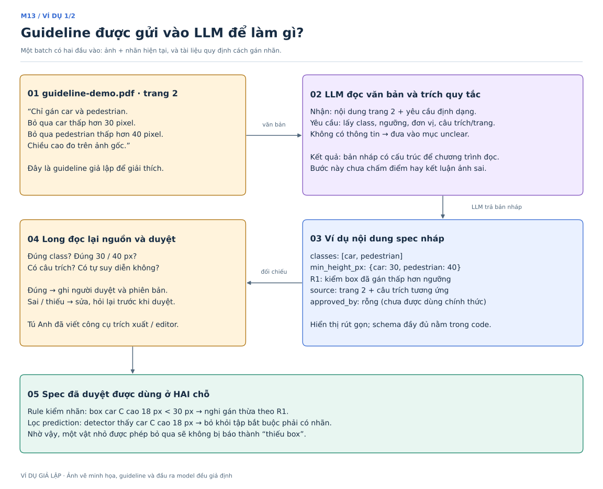
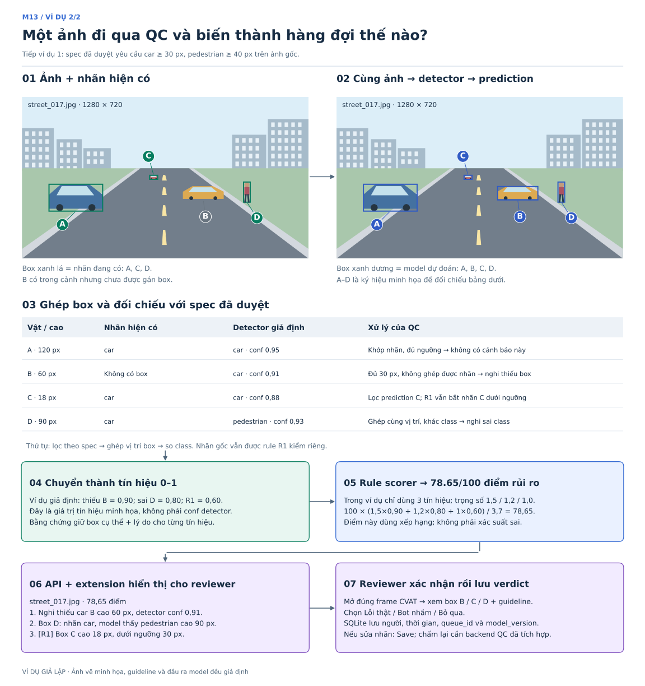

# M13 — Theo một ảnh từ đầu vào đến kết quả review

**Sau khi xem hình:** đọc [hướng dẫn công việc bằng ngôn ngữ dễ hiểu](huong-dan-cong-viec-de-hieu.md) để biết từng người bắt đầu từ đâu, phải giao gì và kiểm tra hoàn thành thế nào.

**Đọc hình 1 rồi hình 2.** Đây là một ví dụ giả lập xuyên suốt, không phải ảnh BDD100K hay kết quả LLM/detector đã chạy. Mục tiêu là nhìn thấy rõ mỗi bước nhận gì, xử lý gì và trả ra gì.

## 1. Đầu vào có cả ảnh, nhãn hiện tại và guideline

Một batch gửi vào hệ thống gồm:

- `street_017.jpg`: ảnh đường phố kích thước 1280 × 720.
- Nhãn hiện tại: box A là `car`, box C là `car`, box D cũng đang mang tên `car`. Vật B có trong ảnh nhưng chưa có nhãn.
- `guideline-demo.pdf`: trang 2 ghi “Chỉ gán car và pedestrian. Bỏ qua car thấp hơn 30 pixel. Bỏ qua pedestrian thấp hơn 40 pixel. Chiều cao đo trên ảnh gốc.”

Ảnh và nhãn đi vào nhánh kiểm ảnh. Tài liệu guideline đi vào nhánh trích xuất luật, sau đó hai nhánh gặp nhau ở bước kiểm nhãn theo spec đã duyệt.

## 2. Guideline → LLM → spec nháp → người duyệt

[Phóng to bằng SVG](diagrams/05-vi-du-guideline-llm.svg).

**LLM nhận:** văn bản guideline kèm vị trí trang và yêu cầu trả dữ liệu theo schema. Ví dụ yêu cầu: “Trích danh sách class, ngưỡng chiều cao và đơn vị. Mỗi thông tin phải có câu trích và trang. Chỗ không nói rõ đưa vào `unclear`, không tự thêm ngưỡng.”

**LLM trả:** bản nháp có `classes`, `min_height_px`, các rule và dẫn chiếu nguồn. Ví dụ car → 30 px, pedestrian → 40 px. Đây là ví dụ nội dung rút gọn, không phải một file spec đầy đủ có thể dùng trực tiếp.

**Long duyệt:** so bản nháp với nguồn, sửa chỗ trích sai, ghi người duyệt và phiên bản trước khi dùng. Tú Anh đã viết phần trích xuất, editor và công cụ duyệt; Long sử dụng và kiểm nội dung, không cần viết lại công cụ này.

**Spec có hai tác dụng:** rule kiểm các box đã gán có tuân thủ guideline không; đồng thời lọc dự đoán detector để vật được phép bỏ qua không bị báo là thiếu nhãn.

LLM ở bước này xử lý tài liệu. Detector xử lý ảnh để tìm vật thể. Nếu thêm VLM, đó là nhánh mở rộng nhận ảnh/crop và câu hỏi về luật phải nhìn bằng mắt; ví dụ cốt lõi dưới đây không cần VLM.

## 3. Ảnh → detector → so với nhãn → tín hiệu → điểm → review

[Phóng to bằng SVG](diagrams/06-vi-du-anh-den-review.svg).

| Vật | Box trên ảnh gốc `[x1,y1,x2,y2]` | Nhãn hiện có | Detector giả định | Hệ thống làm gì? |
|---|---|---|---|---|
| A | `[120,390,360,510]`, cao 120 px | car | car, conf 0,95 | Ghép được, cùng class, đủ ngưỡng; không phát cảnh báo từ các phép kiểm này |
| B | `[720,400,900,460]`, cao 60 px | Không có | car, conf 0,91 | Prediction đủ 30 px nhưng không ghép được nhãn → nghi thiếu box |
| C | `[570,350,606,368]`, cao 18 px | car | car, conf 0,88 | Loại prediction C khỏi tập yêu cầu gán; rule R1 vẫn kiểm nhãn C và báo dưới ngưỡng 30 px |
| D | `[990,380,1020,470]`, cao 90 px | car | pedestrian, conf 0,93 | Ghép được cùng vị trí nhưng khác class → nghi sai tên nhãn |

Để dễ theo dõi, ví dụ giả định box detector trùng tọa độ với các vật thể. Thực tế phải ghép theo độ chồng lấp/IoU, và detector có thể dự đoán sai. Với C, không dùng việc đã lọc prediction nhỏ để kết luận nhãn không được model hỗ trợ; nó được xử lý theo luật kích thước của guideline.

**Sau đối chiếu**, giả sử bộ tính tín hiệu trả ba giá trị: thiếu nhãn = 0,90; sai class = 0,80; guideline = 0,60. Đây là giá trị giả định để giải thích scorer, không có nghĩa lấy trực tiếp confidence của detector làm tín hiệu.

Ví dụ chỉ bật ba tín hiệu này, dùng trọng số trong `configs/weights.yaml` là 1,5; 1,2; 1,0:

`điểm = 100 × (1,5×0,90 + 1,2×0,80 + 1×0,60) / (1,5 + 1,2 + 1) = 78,65`

Khi bật thêm tín hiệu, mẫu số và điểm thay đổi. Điểm 78,65 dùng để xếp thứ tự, không phải xác suất có lỗi 78,65%.

**Xếp hàng đợi:** nếu hai ảnh khác trong batch giả lập có điểm 20 và 5 thì `street_017` đứng hạng 1. API/extension nhận điểm, hạng và ba lý do kèm tọa độ box; reviewer mở frame tương ứng trong CVAT để xác nhận. Xác nhận lỗi và sửa nhãn là hai thao tác khác nhau: verdict được lưu vào SQLite, nhãn sửa phải Save trong CVAT.

## 4. Gắn ví dụ với việc của từng người

| Bước trong ví dụ | Chủ trì | Đầu ra cụ thể |
|---|---|---|
| Đọc tài liệu, trích và chỉnh spec | Công cụ Tú Anh đã viết; Long kiểm và duyệt | Spec áp dụng cho batch, có nguồn và phiên bản |
| Ảnh → prediction → ghép với nhãn | Sơn | Prediction, cặp box đã ghép và tín hiệu thiếu box/sai class |
| Nhãn + spec → lỗi guideline | Long | R1 ở box C, mức rủi ro và lý do có ngưỡng cụ thể |
| Tín hiệu → điểm + thứ tự + bằng chứng | Cường | Queue CSV và evidence JSONL cùng phiên bản |
| Queue → CVAT → verdict | API/extension Tú Anh đã viết, cần ghép dữ liệu thật | Review có người, thời gian, queue/model version |

Dữ liệu số của ví dụ nằm trong [vi-du-du-lieu.json](diagrams/vi-du-du-lieu.json). Dựng lại hình bằng `.venv/bin/python docs/diagrams/build_worked_example.py`. Đối chiếu tiến độ thật tại [bản phân tích và phân công](phan-tich-va-phan-cong-13-10.md); các hình này giải thích thiết kế, không khẳng định toàn bộ pipeline đã chạy.
